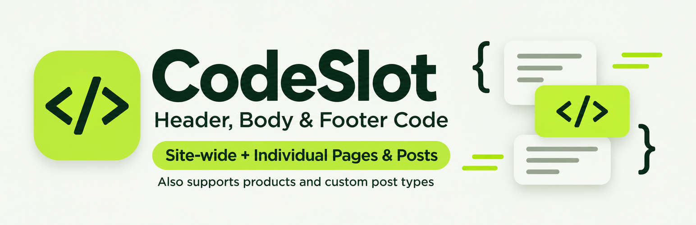

# CodeSlot – Header, Body & Footer Code + Snippet Manager

<picture>
  
</picture>

[Download plugin ZIP](https://github.com/MalikArslanLive/codeslot/releases/download/v1.0.0/codeslot-1.0.0.zip) · [Rules guide](docs/CONDITIONS.md) · [Dependencies](docs/DEPENDENCIES.md) · [Tracking](docs/TRACKING.md) · [Changelog](CHANGELOG.md) · [Support](SUPPORT.md)

By [Malik Arslan](https://malikarslan.com/)

**Add Header, Body and Footer code site-wide or to a single page, post, WooCommerce product, or public custom post type.** Categories, tags and public custom taxonomy terms also have their own slots for their archive pages. All listed features are included under GPL-2.0-or-later.

## Where can I add code?

| Location | What CodeSlot provides |
|---|---|
| Entire site | Separate global Header, Body and Footer editors and enable switches |
| Individual pages and posts | Three independent slots in the native WordPress editor; output only on that item's singular URL |
| WooCommerce products | The same native product fields; four supported WooCommerce insertion hooks |
| Public custom post types | Individual fields, without leaking code to other content items |
| Categories, tags and public custom taxonomies | Individual term fields; output only on that term's own archive |
| Admin and content locations | Admin Header/Footer, before/after main content or a numbered paragraph |
| CSS selector | Before/after, prepend/append or replace matching frontend elements after DOM readiness |
| Shortcodes and manual insertion | Reusable snippets inserted exactly where you choose |
| PHP execution | Frontend, admin, everywhere or manual locations, with privileged access and recovery controls |

Themes must call `wp_head`, `wp_body_open` and `wp_footer`. Attachments and private internal post types are excluded. “Everywhere” PHP is a defined CodeSlot location; it does not promise execution during REST, AJAX, cron or before query setup.

## Included features

- PHP, JavaScript, CSS, HTML, plain text, reusable content and nested-shortcode snippets.
- Global and individual Header/Body/Footer code with ordered output and duplicate-slot prevention.
- AND/OR conditions, exclusions, activation switches and execution priorities.
- Search, filters, sorting, pagination, a separate checkbox column, Edit, Quick Edit, Bulk Edit, Trash/Restore and confirmed permanent deletion from Trash. Native Screen Options controls separate metadata columns, page size and sorting; Status is last.
- Categories, tags, duplication, locking and library templates.
- All/Active/Inactive/Trash views, Undo, inactive restore and confirmed Empty Trash.
- Any/Desktop/Mobile device targeting, start/end schedules, static JavaScript/CSS files and opt-in JavaScript compaction.
- JSON file upload/download and the last 30 changed versions. Unchanged saves create no revision; comparisons label Previous Saved Version and Current Version, with inactive restore.
- Before/after numbered-paragraph insertion in main singular content.
- Confirmed Run Once PHP tasks with atomic claim, output/status records and no automatic retry.
- PHP syntax checks, Safe Mode, error reporting and best-effort direct-error recovery.
- Per-site multisite storage with super-admin management.
- A single-page local library with 142 recipes/setup guides, live search and category filters.
- Private System Info, bounded local logs and virtual ads.txt/app-ads.txt/robots.txt/service-worker.js tools.
- Automatic base tags with optional consent gating for Meta, Google Analytics 4, Google Ads, Google Tag Manager, Pinterest, TikTok and Snapchat integrations, including optional WooCommerce events.

See [feature details and limits](docs/FEATURES.md).

## Install

[Download the current CodeSlot 1.0.0 package](https://github.com/MalikArslanLive/codeslot/releases/download/v1.0.0/codeslot-1.0.0.zip) · [SHA256SUMS](packages/SHA256SUMS)

The current main source, v1.0.0 tag and published release describe the same release. Download the ZIP and verify it with its matching SHA256SUMS.

1. In WordPress, open **Plugins → Add New → Upload Plugin** and select the ZIP.
2. Activate CodeSlot.
3. Open **CodeSlot → Header, Body & Footer** for global slots, or **CodeSlot → Add New** for snippets.
4. Open a page, post, product or public custom post type in its native editor and find **CodeSlot — Header, Body & Footer** for individual code. Use term add/edit screens for archive code.

Requires **WordPress 6.5+ and PHP 7.4+**. No Composer or Node dependencies are needed at runtime. See [requirements and compatibility](docs/COMPATIBILITY.md); companion plugins can require newer PHP versions.

## Add code to one page or post

1. Open the page or post in the native WordPress editor and find **CodeSlot — Header, Body & Footer**.
2. Paste your code into the relevant slot, turn on its enable switch and update the item.
3. Open the saved item's frontend URL to check the output. For example, a script added to one landing page's Footer slot appears on that page only.

WooCommerce products and public custom post types use the same fields. For category, tag or public custom taxonomy archive code, open the term's edit screen. Global code can remain active alongside individual code.

## Use snippets

Choose a type, location, conditions and priority. PHP is entered without PHP tags; JavaScript/CSS without script/style wrappers. Lower priorities run first. Output order is global slots → matching snippets by priority/ID → individual code.

Use `[codeslot id="123"]` for an active visual snippet configured for shortcode insertion. PHP is never exposed through a public shortcode. Manual insertion after query setup: `do_action( 'codeslot_manual', 'Exact snippet name' );`.

New snippets import inactive and unlocked; exact duplicates are skipped. Same-name different versions can be skipped (default), kept as disabled copies, or explicitly replace one matching unlocked entry. Existing snippets change only after explicitly choosing Replace; locked and ambiguous matches are skipped. Review code before activating it. Elementor content uses the underlying WordPress item metadata; edit the fields in WordPress's native editor. Unsaved changes and autosaves do not execute individual code.

## Security and recovery

Management requires `manage_options`, `unfiltered_html` and `edit_plugins`; multisite additionally requires super-admin. PHP has arbitrary full site/server privileges. Review code before activation and keep a website backup and recovery access. Syntax validation and exception handling cannot undo destructive side effects.

For emergency suppression, add `define( 'CODESLOT_SAFE_MODE', true );` to `wp-config.php` before WordPress loads. If needed, deactivate with `wp plugin deactivate codeslot --skip-plugins=codeslot` or rename the plugin folder. Purge page caches after changes/recovery. See [SECURITY.md](SECURITY.md).

## Documentation

- [Beginner guide to conditions and searchable rules](docs/CONDITIONS.md)

[Features](docs/FEATURES.md) · [Development](docs/DEVELOPMENT.md) · [Testing](docs/TESTING.md) · [Compatibility](docs/COMPATIBILITY.md) · [Import schema](docs/IMPORT-SCHEMA.md) · [Support](SUPPORT.md) · [Publishing](docs/PUBLISHING.md)

For code wrapper hints, tracking ID examples, consent setup, files and local tools, see [feature usage](docs/NEW-FEATURES.md) and the [library guide](docs/LIBRARY.md).

## Tracking and JSON files

Enable an ID to install its base tag automatically; optional consent gating is configured on Conversion Pixels. See [tracking setup and provider event matrix](docs/TRACKING.md). Import snippets and restore selected full-backup sections by uploading a .json file (maximum 5 MiB). Uploads stay temporary and are never published as files.

## Import, locks and source labels

Re-importing the same source and configuration skips an existing snippet even if its activation/lock state differs. Repeats inside the same file are skipped too. For different versions with the same name, choose Skip conflicting names (default), Keep both as a disabled copy, or Replace one matching unlocked snippet. The completion notice reports imported, exact duplicates skipped and name conflicts; originals stay unchanged for Skip/Keep both; explicit Replace can update one matching unlocked entry.

Check **Lock against changes** and save to lock a snippet. Uncheck it and save in the full editor to unlock; there is no separate confirmation checkbox. Quick Edit, status and Trash remain protected while locked.

Without WooCommerce, product/cart/checkout/purchase choices remain visible but disabled, with an installation/activation explanation. Saved choices are retained and become available when WooCommerce is active. Page View, supported Click events and base tags remain usable.

HTML source groups global slots, individual post/term slots and visual snippets between CodeSlot Start/End comments, with the relevant scope or ID. Authored code bytes are unchanged. PHP execution and non-HTML responses do not gain HTML comments.

Source labels preserve plain-text and URL-like shortcode values exactly. Inline shortcode/manual markup uses compact comments so labels add no visible whitespace. Selector payloads keep their target DOM unchanged; the server-side selector configuration has boundary comments instead. Multiline source labels are used for global/individual hooks and block snippet locations.

See the [restore choices and notice guide](docs/RESTORE.md) for the exact Skip/Keep both/Replace and Disable/Preserve behavior.

Condition values use title/name searches for public posts/pages/plugin content, post types, categories/tags and roles. “Blog Posts Page” identifies the posts listing; valueless rules have no extra input. See the [complete conditions guide](docs/CONDITIONS.md). JavaScript/CSS use inner source; complete script/style embeds use HTML.

Conversion Pixels initializes base tags from the frontend head before `</head>`; optional consent, provider event switches and verified WooCommerce purchase handling remain in place. Mobile editor controls stay in normal document flow without covering later sections.

## Dependency-aware execution

WooCommerce locations stay visible/disabled when unavailable. A saved unavailable location or reference in Include/Exclude pauses the whole snippet; it is not moved or reinterpreted. Saved source and activation preferences remain intact, with clear paused notices. Use **Required plugins (optional)** for custom integrations. [Read the dependency guide](docs/DEPENDENCIES.md) for deactivation/deletion/reactivation, paused status, imports and explicit requirement removal.

Feature-count badges link to the relevant documentation.

Public URL-path examples are site-neutral: **Example URL path: /your-page/**. Enter only the actual path after your domain, such as `/contact/`, with the page’s exact capitalization and trailing slash.

Global/individual code fields accept up to 1 MiB of UTF-8 source per field. Full restore with no selected sections changes nothing and asks you to select what to restore. See the [restore guide](docs/RESTORE.md) and [release verification](docs/TESTING.md).

The Plugins list provides a Code Snippets action link for authorized code managers, opening CodeSlot → All Snippets directly.

## WordPress.org gallery and media

View the [eight real UI screenshots, icons and banners](wordpress-org/README.md). The submission ZIP includes the final readme with matching screenshot captions. Upload gallery images, icons and banners to SVN’s top-level assets directory after approval; the separate media kit contains the correctly named files. Demo data stays outside the production plugin.

[Download the separate WordPress.org media kit](https://github.com/MalikArslanLive/codeslot/releases/download/v1.0.0/codeslot-wordpress-org-media-1.0.0.zip) · [Final readme.txt](https://github.com/MalikArslanLive/codeslot/releases/download/v1.0.0/readme.txt). Upload only the plugin ZIP for initial submission; the media kit is for later SVN assets.
