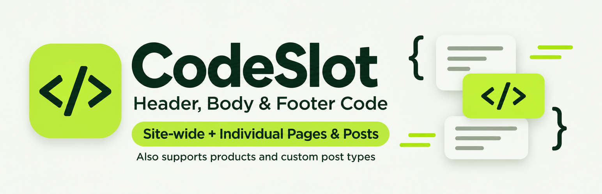
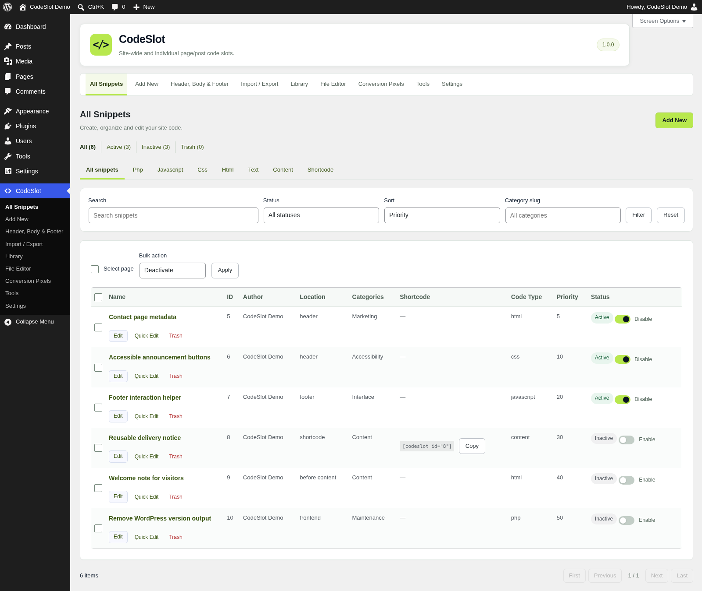
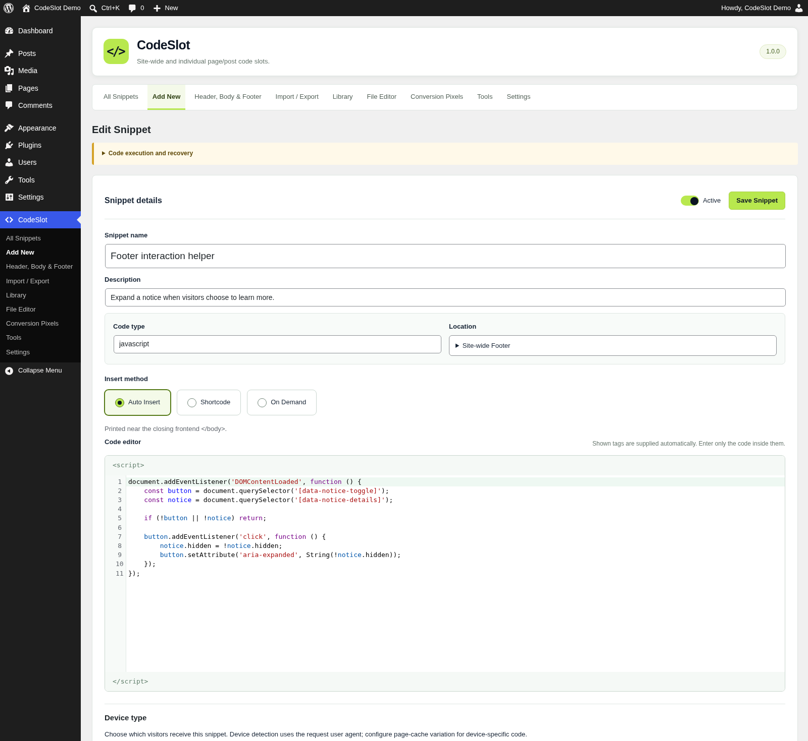
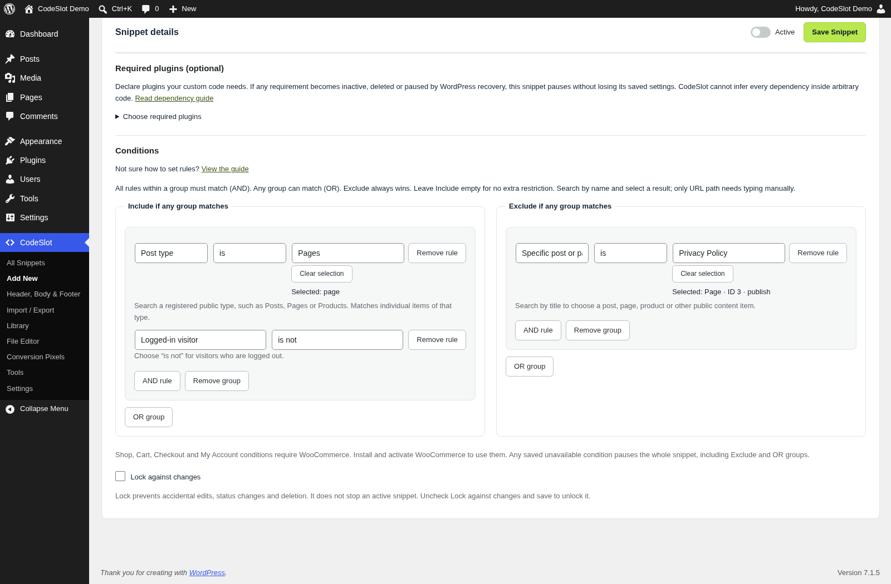
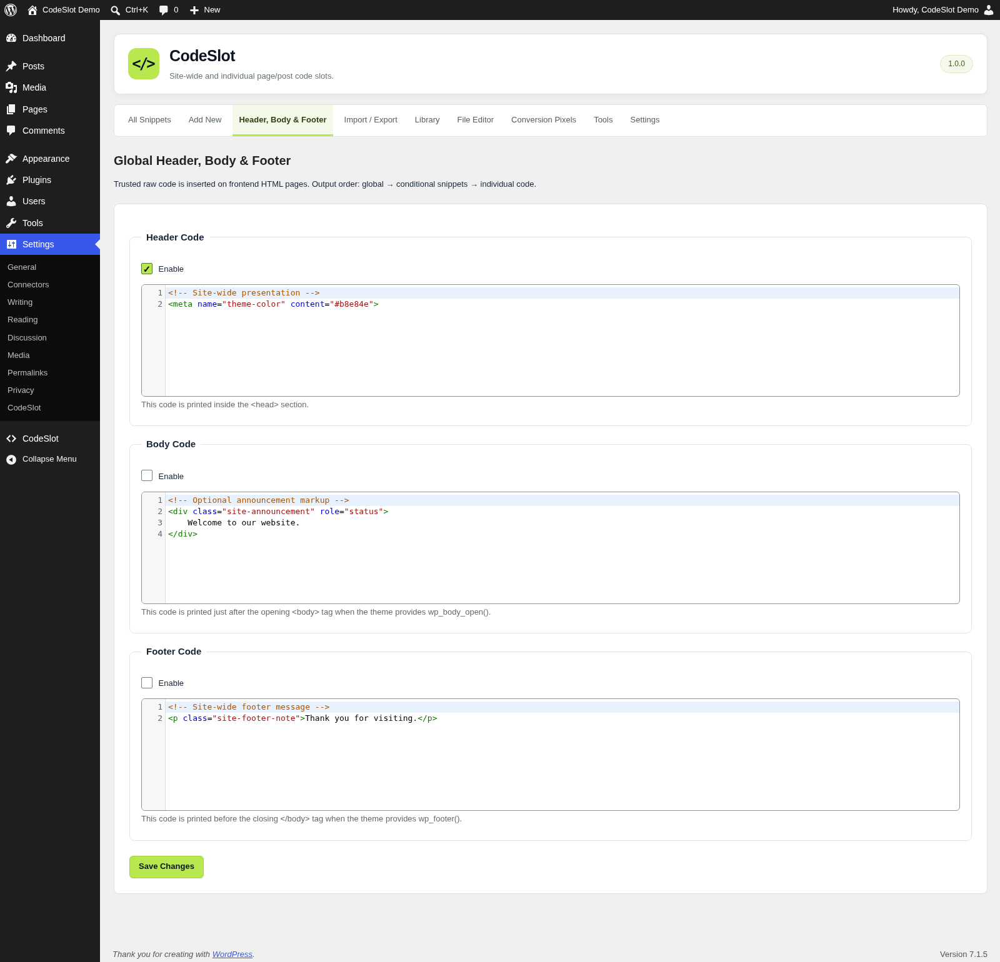
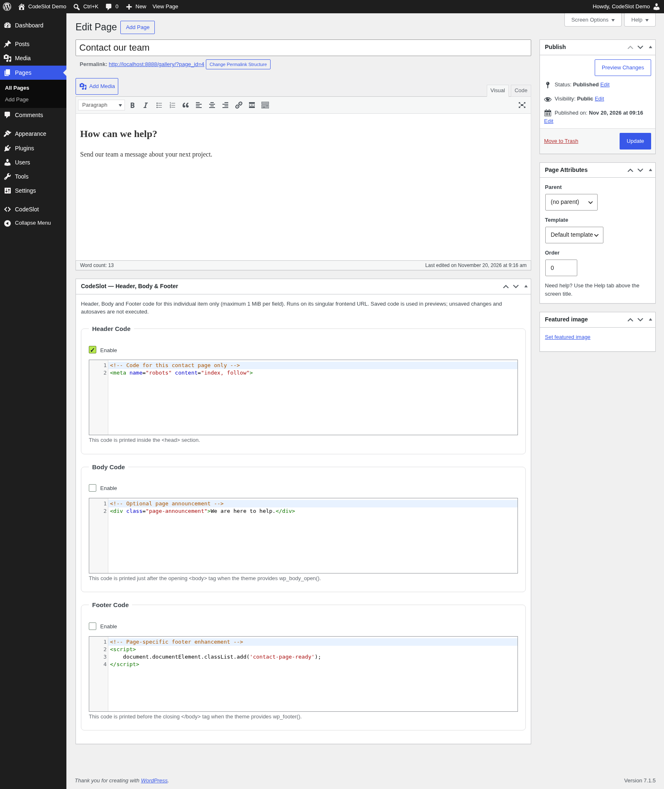
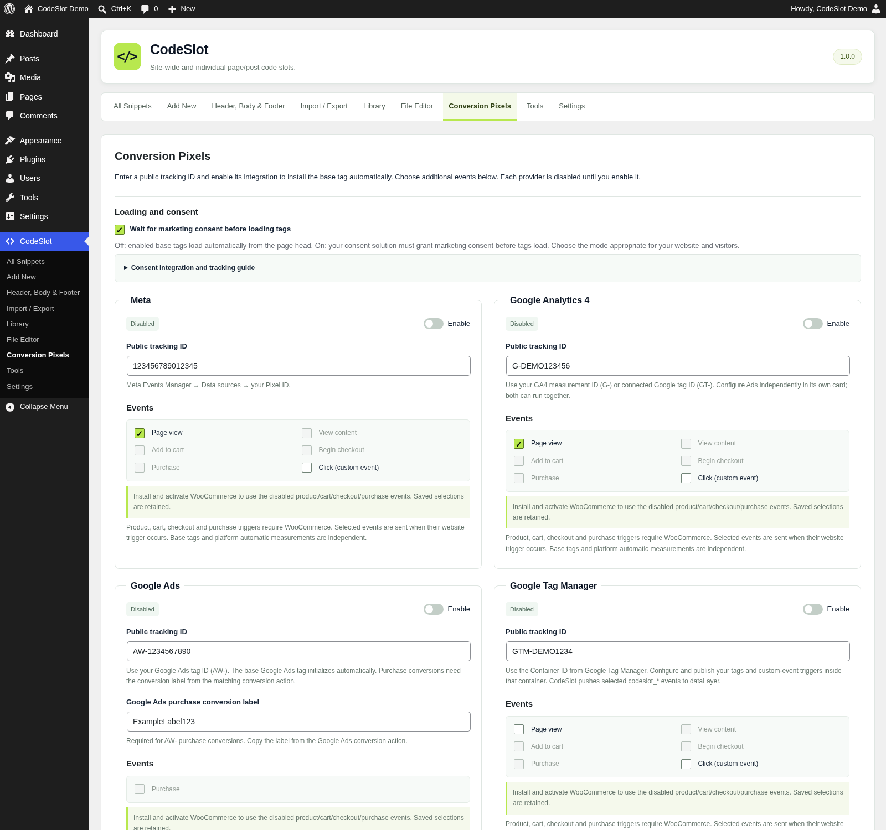
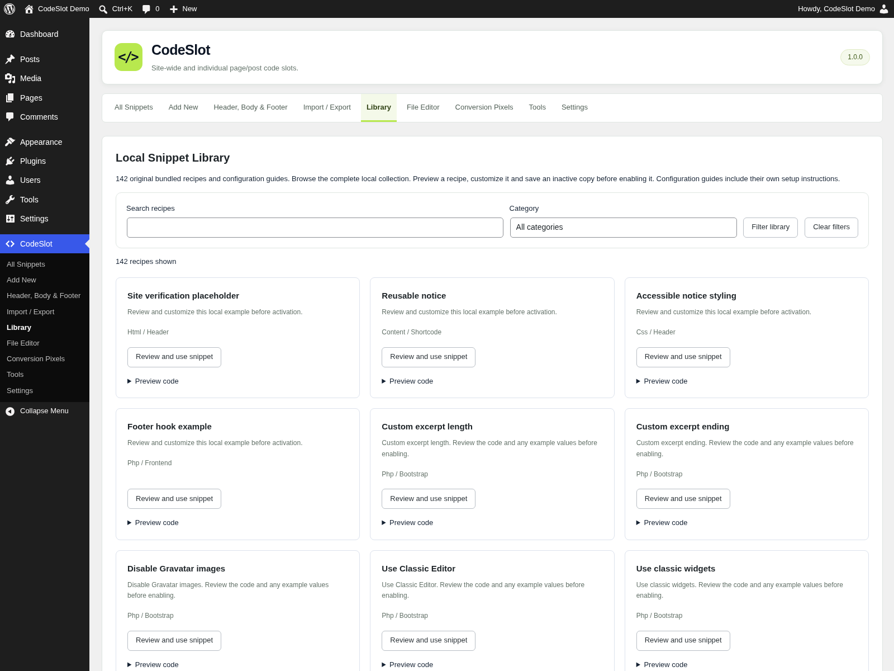
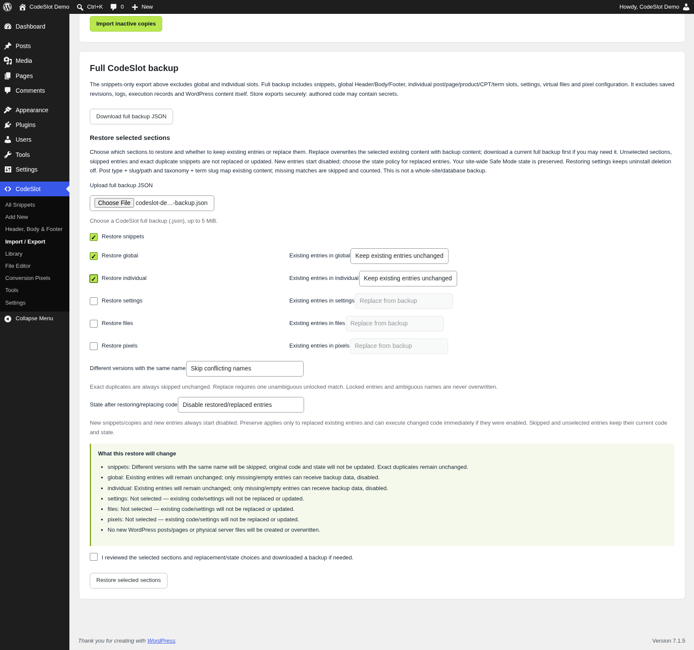

# CodeSlot gallery and branding

[Back to CodeSlot](../README.md)

The gallery, banners and icons are available for GitHub documentation and project promotion. Download the separate `codeslot-media-1.0.0.zip` from [Releases](https://github.com/MalikArslanLive/codeslot/releases/latest). Install the plugin ZIP, not the media ZIP.

## Banner

<picture>
  
</picture>

## Icons

<picture>
  
</picture>

Available sizes: icons 128×128 and 256×256; banners 772×250 and 1544×500. Keep the artwork proportions when resizing.

## Interface gallery

### 1. All Snippets

### 2. Snippet editor

### 3. Conditions and dependencies

### 4. Site-wide Header, Body & Footer

### 5. Individual page code

### 6. Conversion Pixels

### 7. Local recipe library

### 8. Full backup restore

## Image sources and license

Screenshots are genuine WordPress/CodeSlot captures with generic sample data. The individual-page screenshot uses Classic Editor. Tracking IDs are illustrative, providers are disabled, and the restore screenshot is a preview without a submitted restore. Development-only capture helpers are in `demo/`; they are excluded from both download ZIPs.

Icons and banners were created for CodeSlot with AI-assisted artwork. These assets use the project's GPL-2.0-or-later license. WordPress and third-party names remain their owners' trademarks; artwork does not imply endorsement. `ASSET-SHA256SUMS` covers all twelve PNG files.
