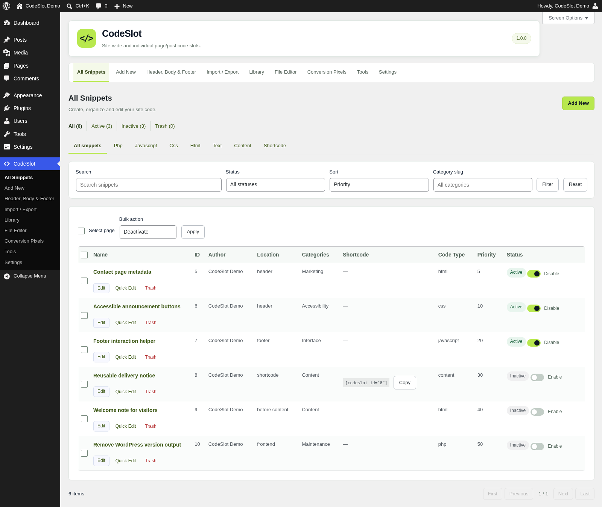
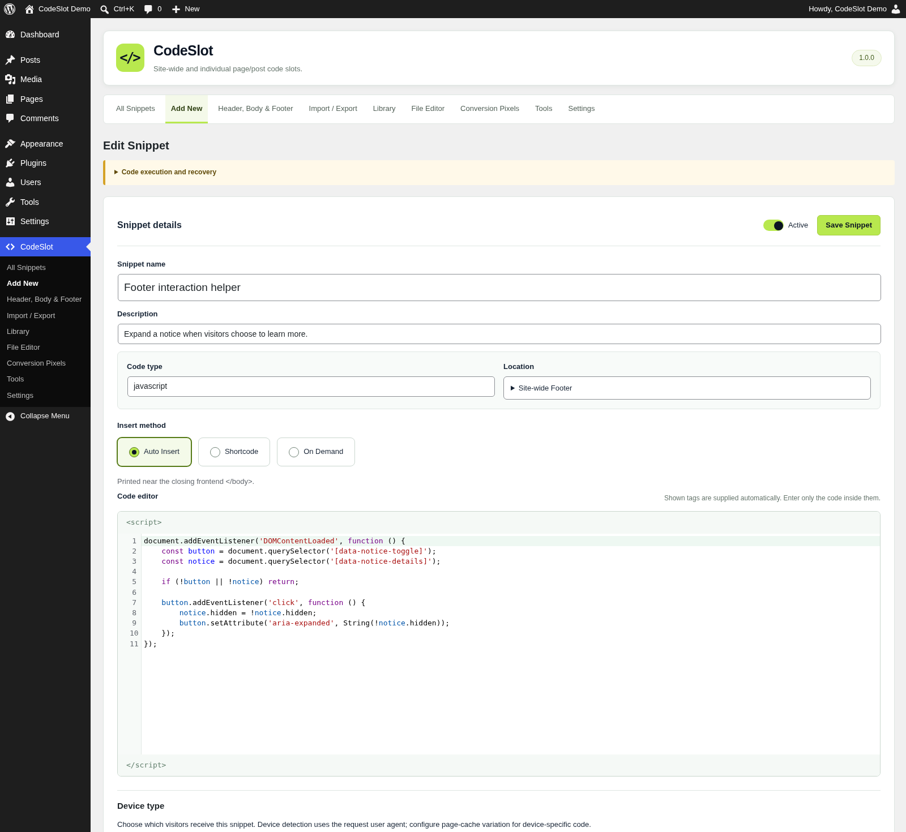
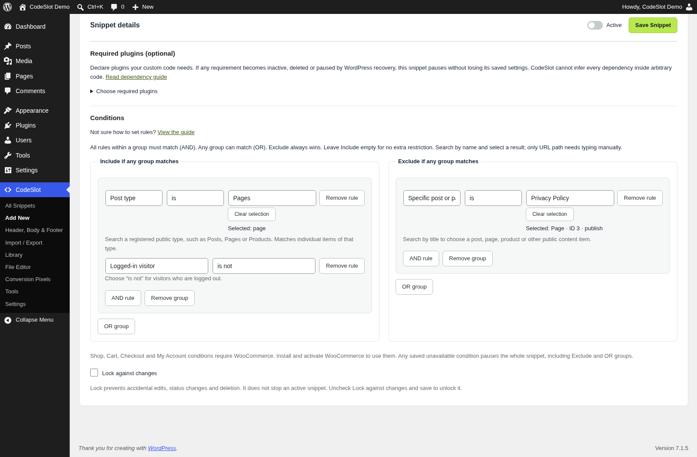
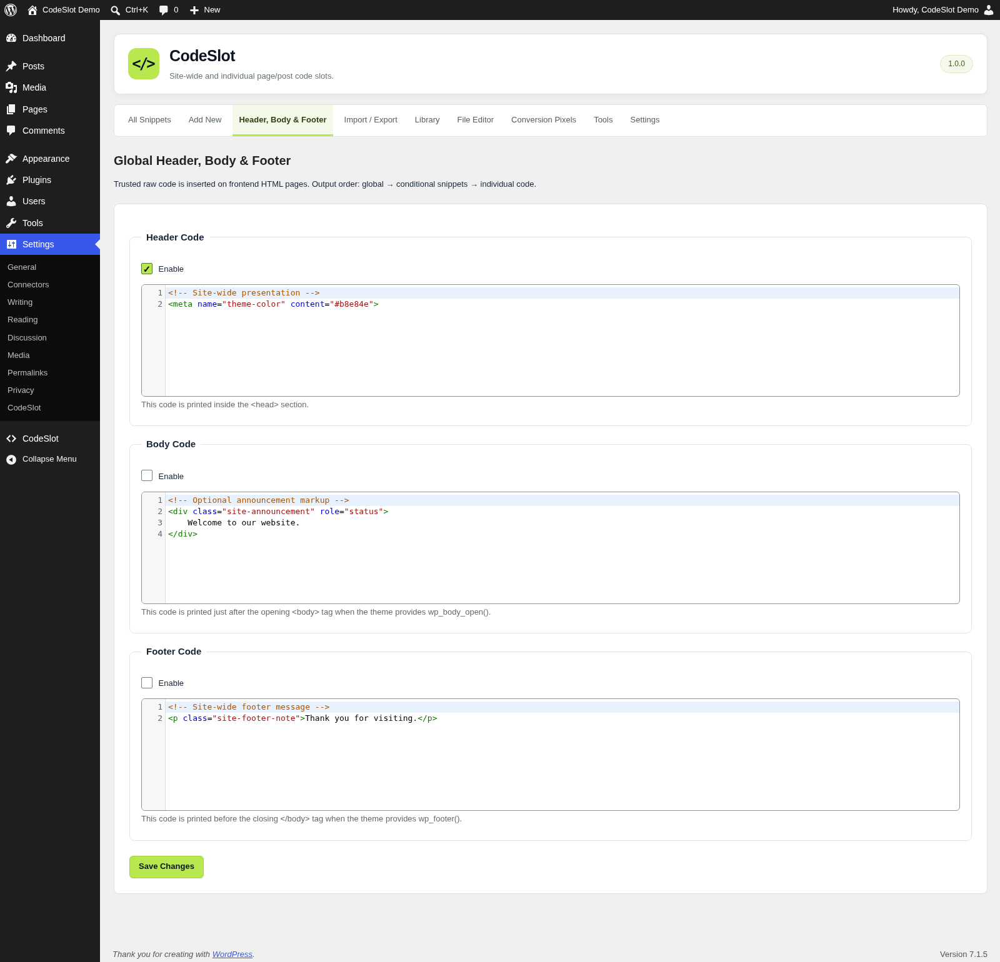
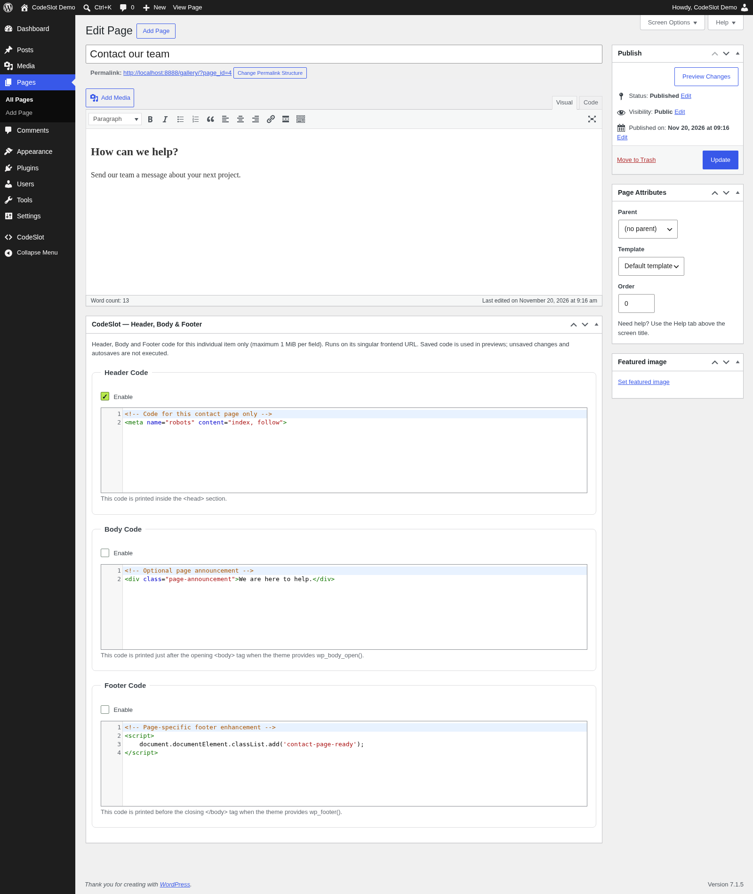
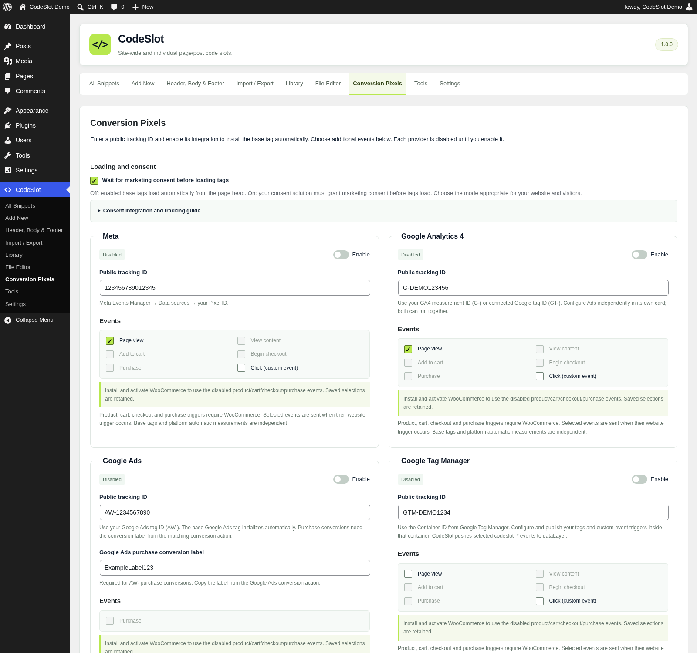
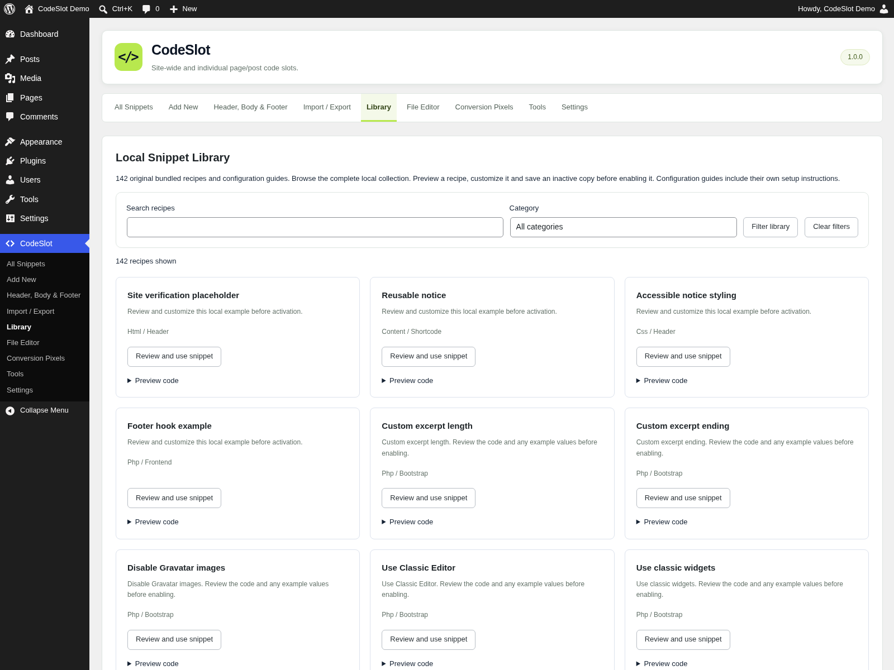
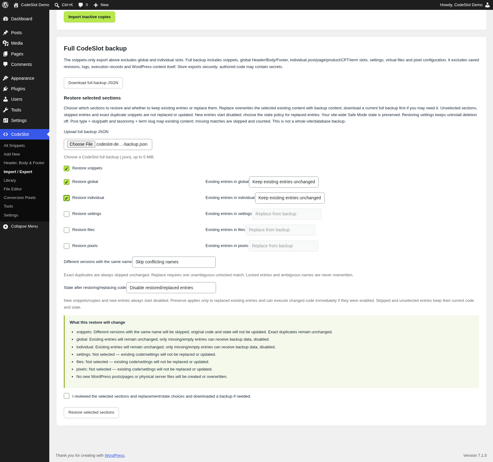

# WordPress.org gallery, icons and banners

CodeSlot adds Header, Body and Footer code **site-wide or to individual pages, posts, products and public custom post types**. These assets use the same lime/forest branding as the administration interface.


## What to upload now

Upload **codeslot-1.0.0.zip** through the WordPress.org plugin submission form. Its final `readme.txt` is already included, with installation, usage, FAQs, advanced guidance, service disclosures and eight numbered screenshot captions. You do not need to upload a second readme separately for that ZIP submission.

The gallery captions can remain in the submitted readme before the images are uploaded. They describe the supplied real screenshots; the media files are uploaded separately after repository access is granted. This preparation does not guarantee approval.

## What to upload after approval

The separate **codeslot-wordpress-org-media-1.0.0.zip** is a media kit, not an installable plugin. It contains these folders:

| Folder | Files | Exact dimensions |
|---|---|---|
| gallery | screenshot-1.png through screenshot-8.png | 1600px wide; heights selected for readable real interface captures |
| icons | icon-128x128.png, icon-256x256.png | 128×128 and 256×256 |
| banners | banner-772x250.png, banner-1544x500.png | 772×250 and 1544×500 |

Copy the **contents** of gallery, icons and banners into the approved plugin SVN repository's top-level `assets/` directory. Do not nest gallery/icons/banners inside SVN assets. Use the lowercase filenames exactly as supplied.

```text
codeslot-header-body-footer-code-snippet-manager/
  assets/
    screenshot-1.png
    screenshot-2.png
    screenshot-3.png
    screenshot-4.png
    screenshot-5.png
    screenshot-6.png
    screenshot-7.png
    screenshot-8.png
    icon-128x128.png
    icon-256x256.png
    banner-772x250.png
    banner-1544x500.png
  trunk/
    codeslot.php
    readme.txt
    ...other production files...
  tags/
    1.0.0/
      ...matching release files...
```

The SVN top-level `assets/` directory is different from the plugin's own runtime `assets/` directory inside trunk. Keep the gallery and branding out of the production ZIP. Do not upload demo scripts, the media kit ZIP, this guide or checksum files as plugin runtime code.

After adding images, set their SVN MIME property so browsers display them:

```sh
svn add assets --force
svn propset svn:mime-type image/png assets/*.png
svn status
```

Review the changes before committing through your approved WordPress.org SVN account. If WordPress.org assigns a different slug, use that assigned repository. Screenshot numbers must continue matching the readme captions. Artwork is optional for initial review and cannot be uploaded to SVN until access is granted.

Official guidance: [Plugin assets](https://developer.wordpress.org/plugins/wordpress-org/plugin-assets/) and [Using Subversion](https://developer.wordpress.org/plugins/wordpress-org/how-to-use-subversion/).

## Gallery

All eight screenshots are actual browser captures on a separate WordPress 7.1.5 demo with generic sample content. Native Classic Editor is used for screenshot 5. No interface was replaced with a mockup. Provider IDs are illustrative, all tracking providers remain disabled, external browser requests were blocked, and the backup restore form was not submitted. Only scrolling, normal controls and viewport sizes were used to frame the screens.

| Screenshot | Screenshot |
|---|---|
| **1. All Snippets**<br> | **2. Code editor**<br> |
| **3. Searchable conditions**<br> | **4. Site-wide slots**<br> |
| **5. Individual page fields**<br> | **6. Conversion Pixels**<br> |
| **7. Local library**<br> | **8. Full backup restore**<br> |

## Reproducing the screenshots

The repository's `demo/seed.php` and `demo/capture.mjs` are development helpers, excluded from the installable ZIP and media kit. Use a fresh, isolated WordPress database; never run the seed on a live site. Activate CodeSlot and the optional Classic Editor plugin for the same native-editor example. The seed rejects repeated use and requires `CODESLOT_GALLERY_DEMO=1`.

Use WP-CLI `eval-file` with that environment variable to seed the disposable site. Then run the capture helper from the CodeSlot repository with `CODESLOT_GALLERY_URL`, `CODESLOT_GALLERY_PATH`, `CODESLOT_GALLERY_USER` and `CODESLOT_GALLERY_PASSWORD` set to your disposable installation. Chromium and development Playwright dependencies are required. Change generic sample content in the helper before seeding a fresh site if needed.

## Artwork and provenance

Icons and banners were created for CodeSlot with AI-assisted artwork and exported to the exact WordPress.org sizes. Screenshots are actual CodeSlot/WordPress interface captures, not generated artwork. These repository assets are distributed under the project's GPL-2.0-or-later license. WordPress and third-party names remain their owners' trademarks; the artwork does not imply endorsement.

The media kit includes the same final readme and an asset checksum manifest. Use the release SHA256SUMS to verify the installable ZIP, media kit and standalone readme.

The assigned directory slug/text domain is `codeslot-header-body-footer-code-snippet-manager`; use that WordPress.org SVN repository unless the review team explicitly changes the assignment. The production ZIP contains that folder. GitHub repository names and the displayed CodeSlot brand do not have to match the directory slug.
